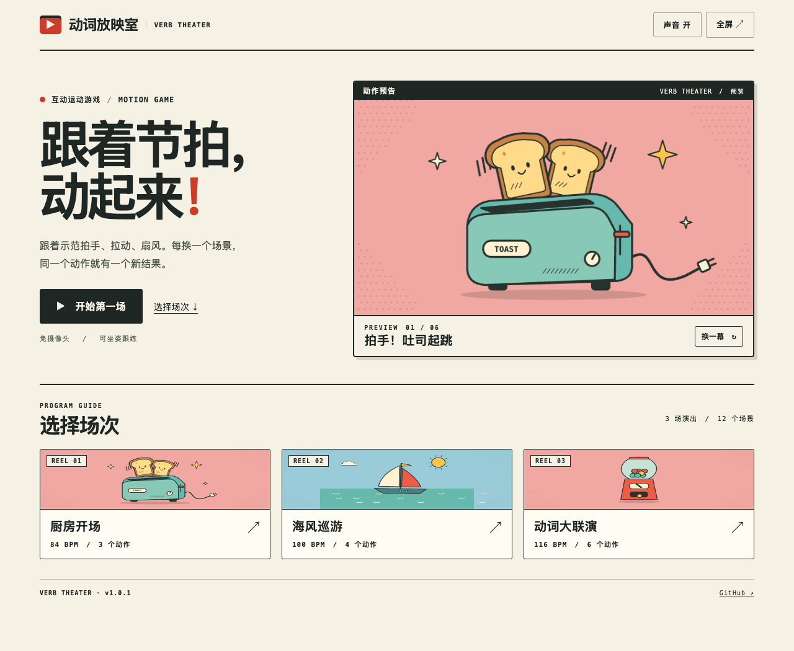
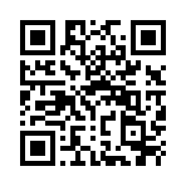

# Verb Theater

[简体中文](README.zh-CN.md) · [Play in your browser](https://verb-theater.xiaosang.cc/) · [Source](https://github.com/holynova/verb-theater)

Clap to pop toast, pull to ring a harbor bell, then keep pulling as a cable car rolls into view. This Chinese-language rhythm game teaches one movement in four beats and reveals two animated scenes for each gesture.

Choose one of three reels and a tempo. Follow six gestures across twelve hand-drawn Canvas scenes with synthesized music and sound effects. Play standing or seated. Camera-free play records completed reels on this device.

## Run locally

Open `index.html` in a browser. The game and its audio can run offline.

## Publish

Run `npm run build` to check the JavaScript and copy the five runtime files into `dist/`. For Cloudflare Pages, connect this repository, select `main`, use `npm run build` as the build command and `dist` as the output directory. A push to the connected production branch triggers publication.

