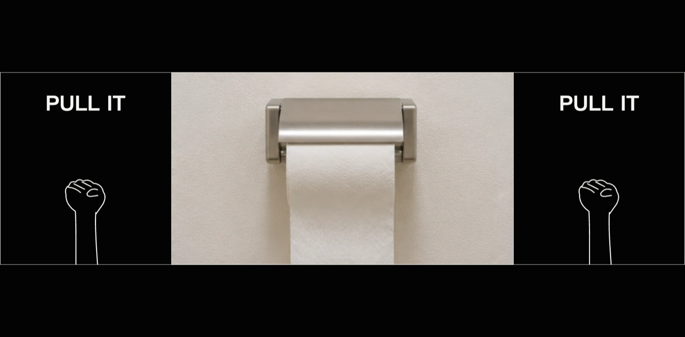

# 动词放映室

[English](README.md) · [在线跟练](https://verb-theater.pages.dev/) · [独立域名 · 等待 DNS 生效](https://verb-theater.xiaosang.cc/) · [游戏源码](https://github.com/holynova/verb-theater)

拍一下手，吐司从面包机里跳出来。向下一拉，港口的钟响了。保持同一个动作，下一幕又拉动了一辆缆车。每个动作先示范四拍，再揭晓两段场景。

选一场演出和播放速度，跟着中文提示完成六个动作、十二幕原创动画。画面用 Canvas 绘制，配乐与拟音在浏览器中合成。可以站着或坐着跟练，免摄像头，完成记录保存在当前设备上。

## 本地运行

用浏览器打开 `index.html` 即可开始。游戏和声音均可离线运行。

## 发布

运行 `npm run build` 检查脚本，并将五个运行文件复制到 `dist/`。在 Cloudflare Pages 连接本仓库，选择生产分支 `main`，构建命令填 `npm run build`，产物目录填 `dist`。推送到已绑定的生产分支即可触发发布。

